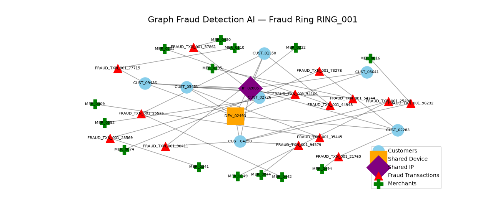

## Figure 1 — Graph Fraud Detection Visualization

Figure 1 illustrates the transaction graph generated by the system. Nodes represent entities and transactions, while connections represent relationships between them. Red triangle nodes represent transactions classified by the model as fraudulent or high-risk.



*Figure 1. Example visualization of the graph-based fraud detection network.*


@"
# Graph Fraud Detection AI

A graph-based fraud detection system using GraphSAGE (Graph Sample and Aggregate) to identify fraudulent transactions by learning from both transaction-level features and relationships within a transaction graph.

## Research Objective

Traditional fraud detection models generally treat transactions as independent rows in a tabular dataset. This project investigates whether graph machine learning can improve fraud detection by modeling relationships between transactions and connected entities.

The system represents fraud-related data as a graph and applies GraphSAGE to learn node representations from neighboring nodes.

## Graph Dataset

The current experiment contains:

- 66,399 nodes
- 328,990 edges
- 5 node features
- 30,899 transaction nodes

The dataset is divided into training, validation, and test subsets.

## Model Architecture

The first graph model uses a two-layer GraphSAGE architecture:

- Input features: 5
- GraphSAGE layer 1: 64 dimensions
- GraphSAGE layer 2: 64 dimensions
- Output classifier: 2 classes
- Aggregation: Mean

Class weighting is used to address the severe imbalance between normal and fraudulent transactions.

## GraphSAGE Test Results

The first GraphSAGE experiment produced the following results on the held-out test set:

| Metric | Result |
|---|---:|
| Accuracy | 99.83% |
| Precision | 94.41% |
| Recall | 100.00% |
| F1 Score | 97.12% |
| ROC-AUC | 100.00% |
| Average Precision | 99.97% |

### Test Confusion Matrix

| | Predicted Normal | Predicted Fraud |
|---|---:|---:|
| Actual Normal | 4,492 | 8 |
| Actual Fraud | 0 | 135 |

The model detected all 135 fraudulent transactions in the test set, while incorrectly flagging 8 normal transactions.

## Why Graph Fraud Detection?

Fraud frequently involves relationships and repeated behavioral patterns.

Examples include:

- Multiple transactions associated with the same device
- Multiple customers associated with an entity
- Repeated use of accounts or identifiers
- Connected transaction activity
- Fraud clusters within a transaction network

A graph model can use these relationships in addition to transaction-level features.

## Red Triangle Fraud Transactions

In graph visualizations, transaction nodes classified by the model as fraudulent or high-risk can be represented using a red triangle.

The red triangle represents a model prediction and should not automatically be interpreted as independently confirmed fraud.

## Project Structure

```text
Graph-Fraud-Detection-AI/
│
├── src/
│   └── training/
│       └── train_graphsage.py
│
├── results/
│   ├── graphsage_metrics.csv
│   ├── graphsage_predictions.csv
│   └── graphsage_training_history.csv
│
├── .gitignore
└── README.md
